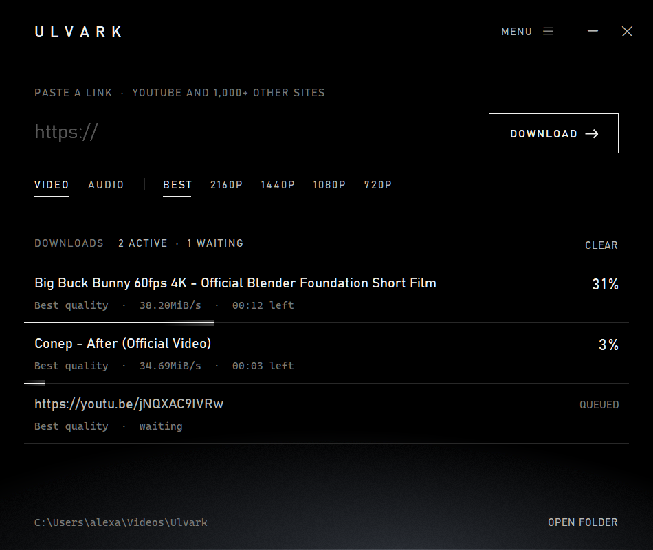

<div align="center">

# P A S T &amp; D O W

Any video. Best quality. One click

   

<a href="https://github.com/4leX-42/PastDow/releases/latest/download/PastDow.exe"><b>DOWNLOAD FOR WINDOWS →</b></a><br><sub>or <code>winget install 4leX-42.PastDow</code></sub>



</div>

| | |
|---|---|
|  **Paste** | One link, or a whole list at once |
|  **Drop** | A .txt full of links onto the window; two downloads at a time |
|  **Select** | Video up to 4K HDR in MKV, MP4 or WebM · audio at source quality, or MP3, M4A, FLAC, WAV, Opus |
|  **Download** | Chapters, subtitles and cover inside the file, straight into your folder |

<p align="center"><sub>YouTube and 1,000+ other sites · install or run portable · no admin rights · fixes itself when a site changes</sub></p>

<details>
<summary> <b>Under the hood</b></summary>

First launch fetches [yt-dlp](https://github.com/yt-dlp/yt-dlp), FFmpeg and Deno from their official releases, checks every SHA-256 and keeps yt-dlp up to date on its own. The interface is a single page in WebView2, already part of Windows 11.

```powershell
dotnet build -c Release
```
</details>

<sub>A front end for yt-dlp (Unlicense), FFmpeg (GPL) and Deno (MIT), run as separate programs · not affiliated with them · built with the help of AI · MIT licence · download only what you have the right to</sub>

<sub>Code signing: applied for free code signing for open source by <a href="https://signpath.org">SignPath Foundation</a>, certificate by SignPath Foundation once approved</sub>
