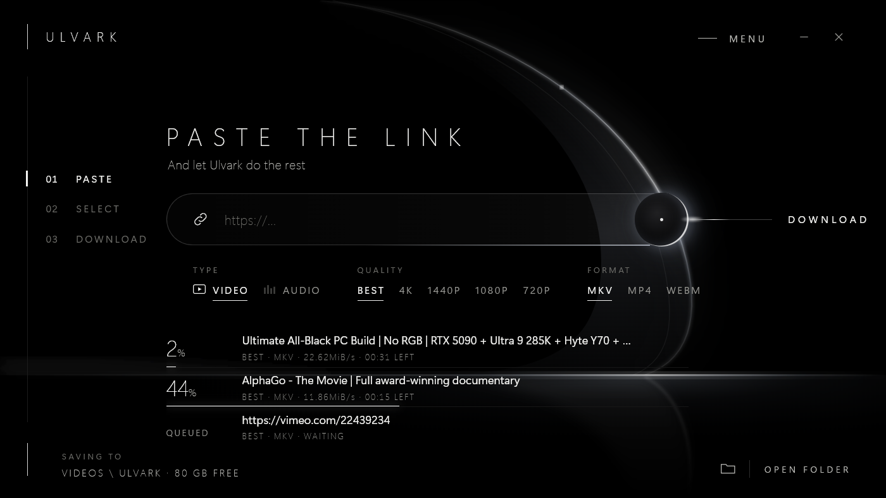

<h1 align="center">U L V A R K</h1>

<p align="center">Any video. Best quality. One click</p>

<p align="center"><a href="https://github.com/4leX-42/Ulvark/releases/latest/download/Ulvark.exe"><b>DOWNLOAD FOR WINDOWS →</b></a></p>

<p align="center"></p>

&nbsp;

**Paste** — one link, a whole list, or drop a .txt full of them

**Select** — video up to 4K HDR in MKV, MP4 or WebM · audio untouched at source quality, or MP3, M4A, FLAC, WAV, Opus

**Download** — chapters, subtitles and cover inside the file, straight into your folder

&nbsp;

YouTube and 1,000+ other sites · install or run portable · no admin rights · fixes itself when a site changes

&nbsp;

### Under the hood

First launch fetches [yt-dlp](https://github.com/yt-dlp/yt-dlp), FFmpeg and Deno from their official releases, checks every SHA-256 and keeps yt-dlp up to date on its own. The interface is a single page in WebView2, already part of Windows 11

```powershell
dotnet build -c Release
```

&nbsp;

<sub>A front end for yt-dlp (Unlicense), FFmpeg (GPL) and Deno (MIT), run as separate programs · not affiliated with them · built with the help of AI · download only what you have the right to</sub>
